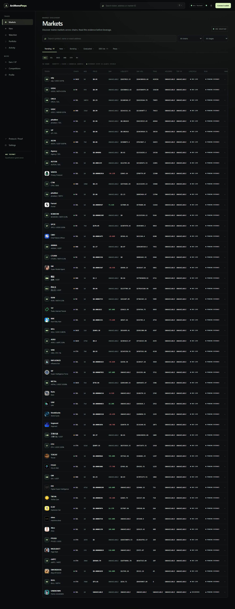

# ◼ ArcMemePerps

Risk-gated multichain meme-asset perpetuals settled on Arc USDC.

[Live App](https://arcmemeperps.vercel.app) · [GitHub](https://github.com/GIFTEDLOV/ArcMemePerps) · [Arc deployment](docs/ARC_TESTNET_DEPLOYMENTS.md) · [Architecture](docs/WINNER_ARCHITECTURE.md) · [Evidence](evidence/winner-rebuild/)



Local winner rebuild: [token terminal](docs/assets/phase10/token-terminal.png) · [Risk Passport](docs/assets/phase10/risk-passport.png) · [visual review](docs/FRONTEND_VISUAL_REVIEW.md)

> The public v1.0.0 URL is the historical release. The `winner-rebuild` branch is the local product rebuild: a trader-first discovery terminal backed by real origin-market observations and explicit evidence boundaries.

## What it is

Meme markets move quickly, but speed is not the same thing as readiness for leverage. ArcMemePerps discovers markets on their origin chains, normalizes lifecycle, surfaces integrity and liquidity evidence, and keeps derivatives eligibility separate from token popularity. Markets that qualify can settle perpetual positions in Arc USDC on Arc Testnet.

The product loop is:

`discover → inspect → qualify → review → wallet sign → keeper → chain → reconcile`

Unknown data stays unavailable. A discovered origin token is not automatically an Arc perp market.

## Why Arc

Arc provides the USDC settlement layer for the perp venue. The Product Testnet deployment uses chain ID `5042002`. The frontend targets the healthy Product deployment; the separate Stress/Security deployment is preserved as destructive security evidence and is never the normal trading target.

## Product surfaces

- Market discovery across Solana, BNB, Base, Ethereum, Robinhood, and Arc where configured.
- Lifecycle-aware rows: new, bonding, graduated, migrated, DEX live, and established only when supported by observations.
- Risk Passport: integrity, provenance, freshness, spot liquidity, directional depth, oracle quality, and derivatives capacity remain separate.
- Arc perp execution surface: collateral approval, vault deposit, immutable pretrade review, wallet authorization, keeper progression, and refresh recovery.
- Public LP, portfolio, profile, activity, watchlist, competitions, and proof surfaces with truthful empty/unavailable states.

## Security model

The Qualification Gate is evidence-backed, not a popularity score. The Execution Gate binds account, chain, market, action, side, collateral, size, execution bound, oracle sequence, versions, nonce, and expiry. Oracle publication uses a 2-of-3 reporter model. The protocol includes governance/timelock, emergency risk reduction, insurance, ADL, and explicit terminal solvency blocking.

The Stress/Security deployment exercised liquidation, insurance, bad debt, ADL, and terminal solvency blocking using the same frozen contract source. It is valuable evidence, not a healthy demo state. See [docs/WINNER_AUDIT.md](docs/WINNER_AUDIT.md) and [docs/ARC_TESTNET_DEPLOYMENTS.md](docs/ARC_TESTNET_DEPLOYMENTS.md).

## Architecture

```text
origin RPCs / provider readers
          ↓
durable MarketUniverse (chain + canonical token identity)
          ↓
observations → lifecycle → integrity → derivatives capacity
          ↓
Arc perp registry projection + qualification proof
          ↓
API / SSE → browser terminal → user wallet
                                  ↓
                         keeper → Arc Testnet → indexer
```

The current rebuild materializes a real DexScreener discovery snapshot through `pnpm winner:discover`. Configured enrichment providers remain explicitly unavailable until credentials and production readers are present; the application does not replace them with synthetic rows, scores, candles, or balances.

## Quickstart

```text
pnpm install
pnpm winner:discover --limit=60
pnpm winner:service --port=8788
$env:VITE_API_URL="http://127.0.0.1:8788/api/v1"
pnpm frontend:dev
```

The frontend runs on `http://127.0.0.1:3001` when available. A local Product API, indexer database, and SSE service are required for live records. The public release infrastructure is documented in [docs/RELEASE.md](docs/RELEASE.md); this rebuild does not replace it or deploy anything.

## Repository map

```text
apps/frontend/       trader-first React/Vite terminal and browser tests
apps/api/             versioned read API and realtime boundary
apps/indexer/         ordered event identity and projection primitives
packages/             domain, risk, lifecycle, providers, persistence, universe
contracts/            frozen Arc Testnet Solidity suite
scripts/              discovery, local service, deployment and operations tools
docs/                 product, architecture, security and operations references
evidence/             sanitized deployment and rebuild evidence
```

## Testing

```text
pnpm lint
pnpm typecheck
pnpm test
pnpm frontend:test
pnpm frontend:build
pnpm e2e
forge fmt --check
forge build
forge test -vvv
```

The contract source remains frozen at SHA `0xaf772928c7dff9735b777f5d612a4a64bf2210d72d90c0a51f786e84702f1c7b`. ArcScan verification status is reported as an external limitation where the explorer exposes address-only records; local creation/runtime parity evidence remains authoritative.

## Known limitations

The rebuild currently has a real discovery universe but no origin token has been promoted into a new Arc perp registration. Discovered markets therefore show `ORIGIN ONLY` and cannot be traded. Token integrity enrichment, directional depth, holders, clusters, and deployer history remain `PENDING` or `UNAVAILABLE` unless a configured provider supplies evidence. This is intentional and safer than presenting a one-token canary as a real market universe.

## License

MIT. See [LICENSE](LICENSE).
