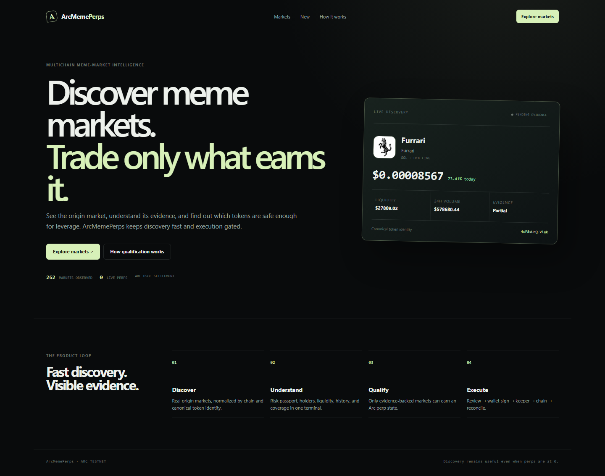
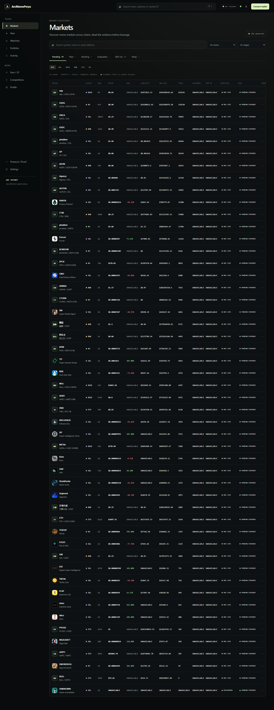
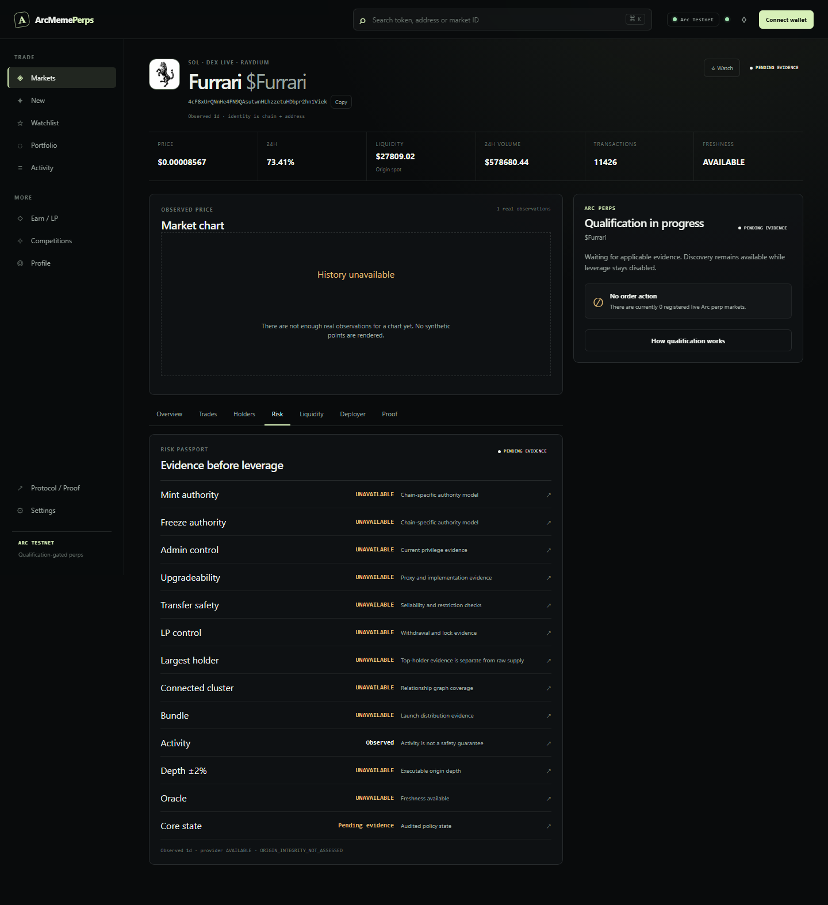
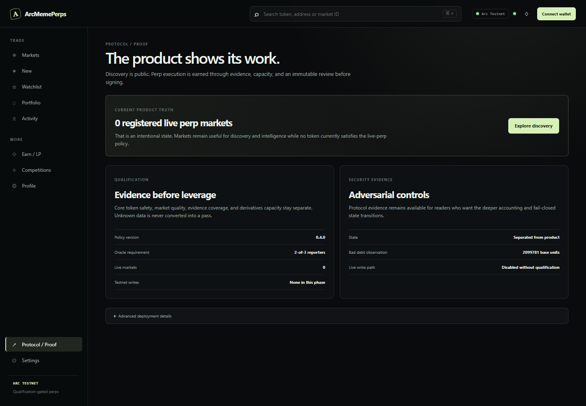
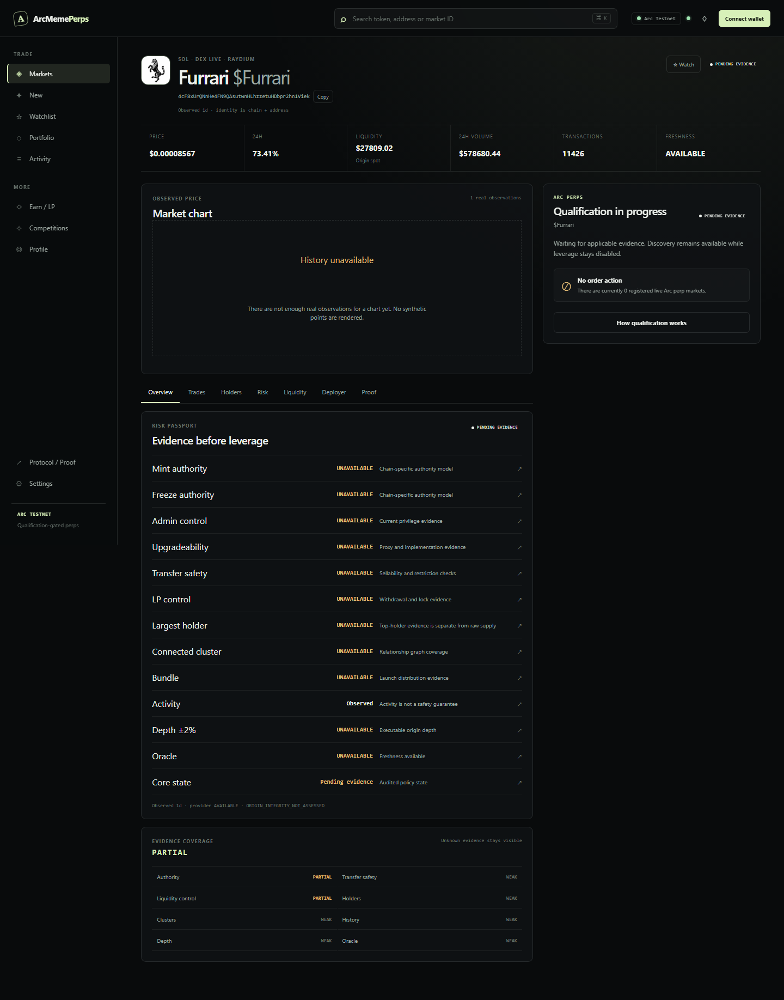
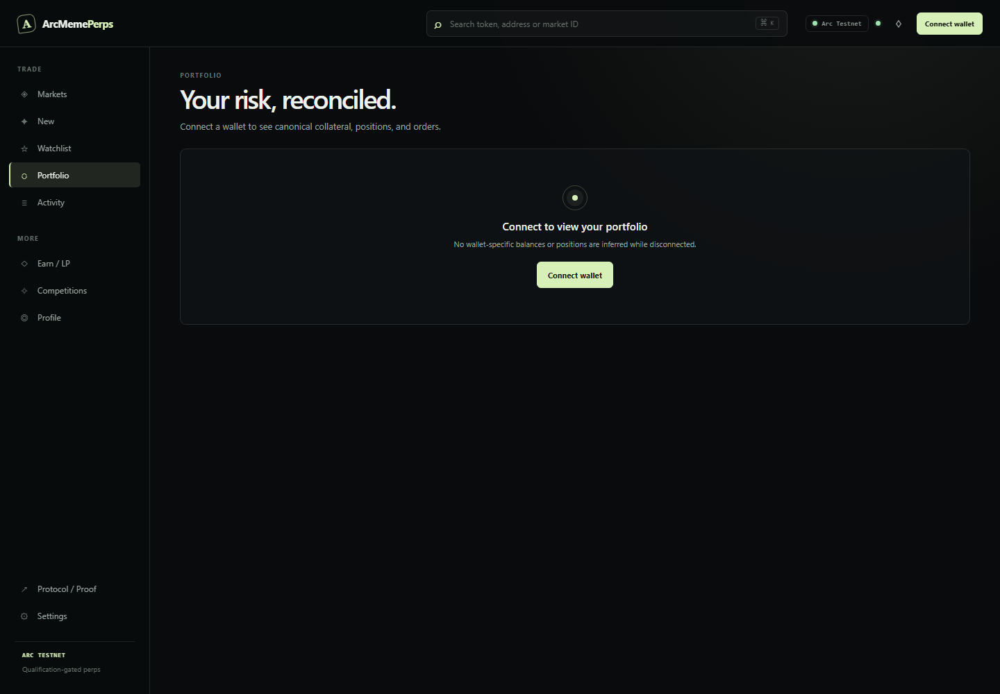
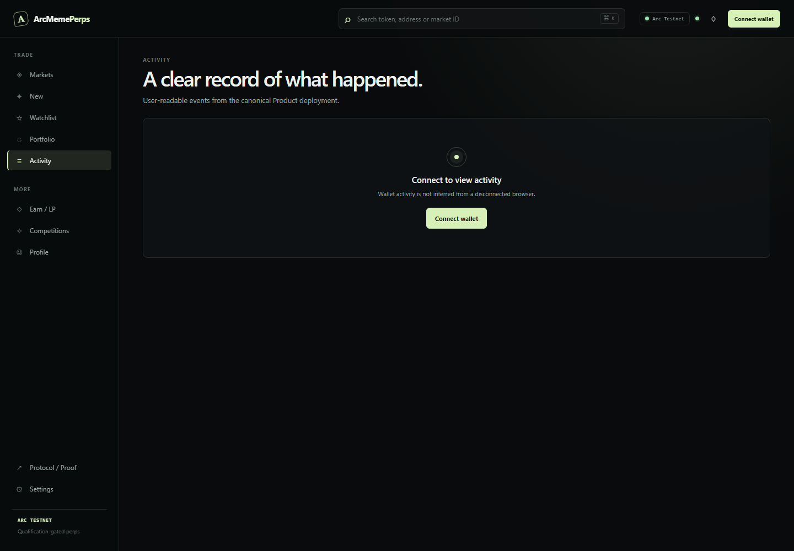

# CLUSTER

Discover meme markets. Inspect the evidence. Enable leverage only after a
market earns it.

CLUSTER is a fail-closed, risk-gated perpetual protocol for multichain
meme markets with Arc USDC settlement. Discovery is public; qualification and
Arc activation are separate decisions.

## Current release-candidate truth

| Product fact | Current state |
| --- | ---: |
| Canonical retained discovered real markets | **262** |
| Latest provider refresh window | **161** |
| Core-qualified real markets | **0** |
| Derivatives-eligible real markets | **0** |
| Registered real Arc perp markets | **0** |
| **Currently activated real perps** | **0** |
| Live real Arc perps | **0** |

**No market currently meets the complete activation policy.** This is an
intentional safety state: discovery and market intelligence remain available,
while trading stays disabled until a real market satisfies the complete
policy. No canary, synthetic market, or famous token is presented as a live
production market.

The 262 figure is the durable canonical discovery universe. The latest
provider refresh window currently contains 161 of those records; the remaining
101 are retained discovery records outside that refresh window and are never
counted as newly observed activity.

The current frontend and historical deployments are Testnet/evidence surfaces.
No Mainnet deployment, Mainnet contract address, or Mainnet user position
exists in this release candidate.

**Mainnet deployment: PENDING FUNDING / DEPLOYMENT CEREMONY.** The local
production wiring targets Arc Mainnet in a truthful pending state; it does not
claim that Mainnet contracts exist. The only remaining major functional step
is the funded, one-shot deployment and verification ceremony.

## Screenshots



| Discovery | Risk Passport | Zero-live-perp proof |
| --- | --- | --- |
|  |  |  |

| Token terminal | Portfolio empty state | Activity empty state |
| --- | --- | --- |
|  |  |  |

Mobile evidence is in [docs/assets/phase12](docs/assets/phase12/), including
markets, Risk Passport, landing, portfolio, and token-terminal views.

## What CLUSTER does

- Discovers origin-chain meme markets and preserves canonical chain + token
  identity.
- Shows lifecycle, liquidity, holders, history, oracle, provenance, and
  evidence coverage without turning unknown data into a pass.
- Separates discovery, core safety, derivatives capacity, qualification, and
  Arc activation.
- Preserves a bounded execution path, keeper flow, liquidation, insurance,
  ADL, LP, timelock, and reconciliation primitives for audited future use.

## How activation works

```text
DISCOVERED
    ↓
CORE SAFETY
    ↓
DERIVATIVES CAPACITY
    ↓
QUALIFIED
    ↓
ARC ACTIVATION
    ↓
LIVE PERP
```

The frozen offchain policy is `risk-rules/0.4.0`. A discovery row is not a
tradable perp, and qualification alone does not activate a market.

## Risk Passport

The Risk Passport keeps authority, transfer safety, liquidity control, holder
and cluster concentration, activity, history, depth, oracle quality, and
derivatives capacity separate. Evidence is labeled with its boundary;
`UNKNOWN`, `PENDING`, and provider outage states are not silently converted to
zero or clear.

## Why Arc

Arc provides USDC-native gas and settlement with deterministic finality. The
Mainnet configuration model is documented in
[docs/MAINNET_CONFIGURATION.md](docs/MAINNET_CONFIGURATION.md) using current
official Arc references. The current product evidence environment remains Arc
Testnet and must not be confused with Mainnet.

## Architecture

```text
origin RPCs / provider readers
          ↓
durable market universe: chain + canonical token identity
          ↓
observations → lifecycle → core safety → derivatives capacity
          ↓
qualification proof → Arc registry projection → bounded execution
          ↓
API / SSE → browser terminal → wallet
                              ↓
                     keeper → Arc → indexer → reconciliation
```

The browser does not calculate qualification, liquidation eligibility,
oracle validity, canonical PnL, or system health. Contract/indexer state is the
authority after restart.

## Contract and economic model

The frozen Solidity source covers market identity, qualification binding,
oracle quorum and replay protection, risk limits, USDC custody, positions,
funding, liquidation, insurance, bad-debt accounting, ADL, public LP
withdrawal controls, emergency reductions, and governance timelock.

- Frozen contract source SHA:
  `0xaf772928c7dff9735b777f5d612a4a64bf2210d72d90c0a51f786e84702f1c7b`
- Final policy: `risk-rules/0.4.0`
- Mainnet genesis expectation: zero registered markets, zero live markets,
  zero OI, zero positions, zero bad debt, and `solvencyBlocked = false`.

## Testnet proof and security evidence

Historical Product Testnet activity proves that signed order submission,
keeper progression, positions, settlement, and reconciliation were exercised.
The separate Stress/Security deployment proves insurance, liquidation, ADL,
and terminal insolvency containment. It is intentionally insolvent in its test
scenario and is never a frontend default, production target, or Mainnet
target. Neither deployment is a real-token Mainnet trade.

See [docs/FINAL_FEATURE_REALITY.md](docs/FINAL_FEATURE_REALITY.md) for the
feature-by-feature reality labels and evidence boundaries.

## Security and release safety

- [Mainnet configuration model](docs/MAINNET_CONFIGURATION.md)
- [Mainnet role plan](docs/MAINNET_ROLE_PLAN.md)
- [Mainnet deployment runbook](docs/MAINNET_RUNBOOK.md)
- [Final feature reality audit](docs/FINAL_FEATURE_REALITY.md)
- [Security policy](SECURITY.md)

Mainnet is not deployed by this release candidate. A future deployment must
use a fresh deployment of the exact frozen source, a least-privilege role
ceremony, explicit USDC/RPC checks, and the zero-market assertions in the
runbook. There is no admin shortcut around qualification or oracle checks.

## Tests and local development

```text
pnpm install
pnpm winner:discover --limit=60
pnpm winner:service --port=8788
$env:VITE_API_URL="http://127.0.0.1:8788/api/v1"
pnpm frontend:dev
```

Validation commands:

```text
pnpm lint
pnpm typecheck
pnpm test
pnpm frontend:test
pnpm frontend:build
pnpm e2e
forge fmt --check
forge build
forge test
```

The current local release candidate passes the TypeScript, frontend, provider,
risk, capacity, API, indexer, frontend build, and Solidity checks available in
the workspace. See the final audit for any environment limitations on tool
invocation.

## Repository structure

```text
apps/frontend/       React/Vite discovery terminal and browser tests
apps/api/             versioned read API and realtime boundary
apps/indexer/         ordered event identity and projections
apps/keeper/          bounded execution worker
apps/reporter/        oracle report worker boundary
packages/             domain, risk, lifecycle, providers, persistence, oracle
contracts/            frozen Arc Solidity suite
scripts/              discovery, services, deployment preflight, operations
docs/                 product, security, operations, and release evidence
evidence/             sanitized deployment and visual evidence
```

## Known limitations

No real market currently satisfies the complete `0.4.0` activation policy.
Provider enrichment, holder/cluster coverage, direct depth, and deployer
history remain explicitly unavailable or partial where a verifiable reader is
not configured. Portfolio, activity, notifications, competitions, and LP
surfaces remain truthful empty or primitive states until canonical records
exist.

The historical public URL is retained as a reference only:
[arcmemeperps.vercel.app](https://arcmemeperps.vercel.app). This Phase 12 pass
performed no Vercel deployment, Mainnet write, Git push, or public release.

MIT. See [LICENSE](LICENSE).
