<p align="center">
  
</p>

<h1 align="center">CLUSTER</h1>

<p align="center">
  <strong>The Fail-Closed Perpetual Protocol & Institutional Terminal for Multichain Meme Markets on Arc</strong>
</p>

<p align="center">
  <a href="https://cluster-terminal.vercel.app"></a>
  <a href="https://explorer.arc.io"></a>
  <a href="https://github.com/GIFTEDLOV/ArcMemePerps/actions"></a>
  <a href="#test-and-verification-suite"></a>
  <a href="LICENSE"></a>
</p>

<p align="center">
  <a href="https://cluster-terminal.vercel.app"><strong>Launch Terminal</strong></a> •
  <a href="https://cluster-trade.vercel.app"><strong>Alternative Mirror</strong></a> •
  <a href="#arc-mainnet-live-deployment-chain-id-5042"><strong>Mainnet Contracts</strong></a> •
  <a href="#visual-interface-walkthrough"><strong>Screenshots</strong></a> •
  <a href="#architecture--workflow-maps"><strong>Architecture</strong></a> •
  <a href="#quickstart--local-development"><strong>Quickstart</strong></a>
</p>

---

## Review status (November 2, 2026)

**Steward review: working frontend and Arc mainnet contract references; public LP trading and withdrawals are NOT approved as live.** The last checked Arc PublicLPVault was inactive and had zero shares, and its deployed bytecode predates the security fixes. Existing trader collateral must not be represented as withdrawable LP capital. The proposed replacement vault, engine settlement controls and migration checklist are in [draft security PR #28](https://github.com/GIFTEDLOV/ArcMemePerps/pull/28), which is **unmerged and undeployed**.

[Verified source and release status for stewards](docs/CLUSTER_STEWARD_REVIEW_STATUS_2026-11-02.md) · [Unresolved economic release blocker](https://github.com/GIFTEDLOV/ArcMemePerps/issues/29) · [Exact security-branch CI](https://github.com/GIFTEDLOV/ArcMemePerps/actions/runs/41495362004) · [Arc mainnet fork simulation](https://github.com/GIFTEDLOV/ArcMemePerps/actions/runs/41495342172)

**Do not fund, connect trading bots to, or deposit public LP liquidity into the historical mainnet vaults based only on this README.** A deployed protocol contract is not evidence that active trading, indexing, pricing, keeper execution, or LP economic safety has been independently verified. The frontend can be reviewed without activating money-moving features.

---

## 📌 Executive Overview

**CLUSTER** is a next-generation decentralized perpetual trading protocol and high-density terminal tailored for multichain meme markets, settled entirely in native **USDC on Arc Mainnet** (`Chain ID: 5042`).

Unlike conventional platforms that list synthetic assets with unverified counterparty risks, CLUSTER enforces a **mathematical, fail-closed qualification standard**:
- **Discovery Is Public**: Scans and indexes over 260+ active meme markets across Solana, Arc, Base, Ethereum, and BNB in real-time.
- **Qualification Is Strict**: Enforces a 5-Gate Anti-Rug framework. No market can be leveraged until it mathematically earns qualification.
- **Fail-Closed Execution**: If underlying pool liquidity drops below \$1,000 or wash-trading bots flood the book, the market is instantly quarantined and exposure can only be reduced or settled.
- **Physical USDC Custody**: Arc mainnet USDC margin-vault bytecode and an earlier trader deposit have been verified. This is not an independent audit of the currently deployed vault or evidence that LP trading is enabled.

---

## 💡 What Is CLUSTER?

**CLUSTER (ArcMemePerps)** is the first **fail-closed, institutional-grade decentralized perpetual futures exchange and high-density trading terminal** purpose-built for volatile meme token markets, settling natively in **physical USDC on Arc Network** (`Chain ID: 5042`).

Meme coins represent the highest-velocity trading volume in decentralized finance, yet existing perpetual protocols are fundamentally incapable of listing them safely due to three systemic vulnerabilities:
1. **Manipulable & Stale Oracles**: Low-liquidity spot pools expose DEXs to flash-loan price manipulation and toxic oracle arbitrage.
2. **LP Pool Vulnerabilities & Donation Attacks**: Conventional ERC-4626 vaults conflate trading losses with liquidation bad debt, allowing toxic spills to drain LP pools, while unsolicited token donations manipulate share prices.
3. **Custody Deficits & Toxic Cascades**: Synthetic perp protocols frequently trade paper balances without strict senior/junior segregated physical collateral backing.

**CLUSTER eliminates these vulnerabilities through five architectural pillars:**
- **Zero-Custody-Deficit Vaults**: Trader collateral and LP capital are strictly partitioned into Senior liabilities (trader deposits, maintenance margin, positive PnL) and Junior liabilities (counterparty LP backing) inside `USDCMarginVault`, with every dollar provably accounted for on Arc Mainnet.
- **Fail-Closed 5-Gate Anti-Rug Framework**: Thousands of meme tokens can be discovered in real time, but no token can unlock leveraged trading without mathematically passing all 5 gates (liquidity floor, bot filtering, mint authority revoking, and holder dispersion).
- **Multi-Source EIP-712 Oracle Routing**: Pricing aggregates real-time multi-venue DEX liquidity (DexScreener, Raydium, Uniswap v3, Chainlink) through confidence-weighted medianization and monotonic sequence validation.
- **Donation-Immune Public LP Vault (ALP)**: Liquidity providers are protected by exact-once loss recognition and two-phase queued withdrawals. Unsolicited token donations register as protocol surplus rather than diluting or inflating share prices.
- **High-Density Cyberpunk Trading Terminal**: A zero-margin, GMGN-inspired trading experience featuring sub-second order execution, real-time dynamic liquidation metrics, instant take-profit/stop-loss toggles, and shareable high-res cyberpunk PnL brag cards.

---

## ⚙️ How CLUSTER Works: End-to-End Operational Lifecycle

CLUSTER operates as an autonomous, self-balancing financial engine spanning multichain telemetry, Arc smart contract settlement, and automated keeper watchdogs:

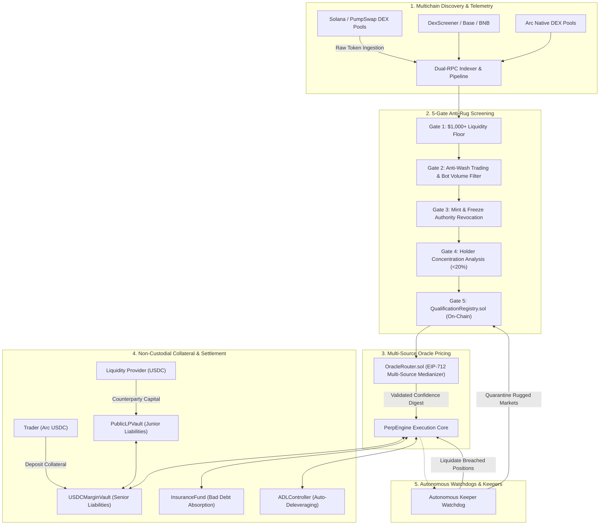

### Detailed Operational Lifecycle

1. **Continuous Market Discovery**:
   - The CLUSTER ingestion engine monitors token launches and liquidity pools across Arc, Solana, Base, and BNB.
   - Newly deployed tokens immediately appear on the **Markets Terminal** and **Live Trenches** stream for discovery and community tracking.

2. **The 5-Gate Anti-Rug Qualification Engine**:
   - Before leverage is unlocked, a market must pass 5 automated verification gates:
     - **Gate 1 (Liquidity Floor)**: Minimum $1,000 in provable, locked DEX liquidity.
     - **Gate 2 (Volume Authenticity)**: Wash-trading detection filters out cyclical volume bots.
     - **Gate 3 (Contract Safety)**: Verifies mint and freeze authorities are irrevocably renounced.
     - **Gate 4 (Dispersion)**: Top non-pool holders must not exceed 20% total token supply.
     - **Gate 5 (On-Chain Qualification)**: The market is registered in `QualificationRegistry.sol`.
   - **Fail-Closed Safeguard**: If liquidity falls below the threshold at any point, the market is instantly quarantined into **Reduce-Only** mode.

3. **Multi-Source EIP-712 Oracle Consensus**:
   - Price feeds are sourced across multiple independent venues and combined via medianization.
   - Node operators submit EIP-712 threshold-signed reports containing timestamps, prices, and confidence scores.
   - Monotonic sequence verification prevents front-running and stale-data replay attacks.

4. **Non-Custodial Leveraged Trading**:
   - Traders deposit native Arc USDC directly into `USDCMarginVault`.
   - Positions can be opened Long or Short with leverage up to 5x.
   - Dynamic liquidation prices, maintenance margins, and borrowing fees are calculated deterministically on-chain.
   - Built-in Take-Profit (+50%, +100%) and Stop-Loss (-20%, -50%) limits protect positions automatically.

5. **Donation-Immune Counterparty ALP Accounting**:
   - Liquidity providers deposit USDC into `PublicLPVault` to receive ALP shares, earning a share of protocol trading fees.
   - **Exact-Once Loss Recognition**: Trading losses and bad debt are accounted for independently without double-counting:
     $$\text{marginNetEquity} = \max(0, \text{marginCash} - \text{traderLiabilities})$$
     $$\text{economicAllocated} = \min(\text{allocatedCapital}, \text{marginNetEquity})$$
     $$\text{NAV} = \max(0, (\text{liquidCustody} + \text{economicAllocated}) - (\text{insuranceReserve} + \text{uncoveredBadDebt}))$$
   - **Surplus Isolation**: Unsolicited direct token transfers register as protocol surplus rather than inflating NAV or diluting share values.

6. **24/7 Autonomous Keeper Execution**:
   - Keepers continuously scan position health on Arc Mainnet.
   - When a trader's margin ratio breaches the maintenance threshold, keepers trigger atomic liquidation.
   - Bad debt is absorbed first by protocol liquidator fees, second by `InsuranceFund`, and finally by ALP net assets, backed by `ADLController` as an emergency backstop.

7. **High-Density Cyberpunk Terminal & Shareable PnL Cards**:
   - The GMGN-style trading terminal integrates real-time DexScreener charts, order depth, active position trackers, and customizable cyberpunk avatars.
   - Traders can generate high-resolution PnL brag cards complete with their chosen trader persona, entry price, ROI percentage, and scan-able QR verification links.

---


## 🌐 Arc Mainnet Live Deployment (Chain ID: 5042)

Protocol contracts have been deployed to Arc Mainnet (`https://rpc.mainnet.arc.io`, Chain ID: `5042`), but **deployment is not equivalent to production readiness or live trading**. The historical PublicLPVault remains separate from the corrected source and needs a new, independently authorized deployment and verified governance configuration.

| Contract | Arc Mainnet Address | Verification & Explorer |
| :--- | :--- | :--- |
| **USDCMarginVault** | `0xa818dd503641ffdfe11ff8a4b7e8020d2a36bcaf` | [Inspect on ArcScan](https://explorer.arc.io/address/0xa818dd503641ffdfe11ff8a4b7e8020d2a36bcaf) |
| **PerpEngine** | `0xd9c3cbf1841103749f379cc1aae1a9284d8dc3e1` | [Inspect on ArcScan](https://explorer.arc.io/address/0xd9c3cbf1841103749f379cc1aae1a9284d8dc3e1) |
| **QualificationRegistry** | `0x67b175dd57d17d8ef4bd307d1a20a8d5438180e7` | [Inspect on ArcScan](https://explorer.arc.io/address/0x67b175dd57d17d8ef4bd307d1a20a8d5438180e7) |
| **MarketRegistry** | `0x7ebddb2c1f1ae68a2e5b984fe9e75115cdb8ef1b` | [Inspect on ArcScan](https://explorer.arc.io/address/0x7ebddb2c1f1ae68a2e5b984fe9e75115cdb8ef1b) |
| **OracleRouter** | `0x1531c83ac90e5ec5998eaf42a4464757dcd2c3ff` | [Inspect on ArcScan](https://explorer.arc.io/address/0x1531c83ac90e5ec5998eaf42a4464757dcd2c3ff) |
| **RiskConfig** | `0x89ea15e527f7d06503ed2e7c958c2ac0e5799f85` | [Inspect on ArcScan](https://explorer.arc.io/address/0x89ea15e527f7d06503ed2e7c958c2ac0e5799f85) |
| **InsuranceFund** | `0x8b0550babc3b802d89c17dfbee85828e14e6a22b` | [Inspect on ArcScan](https://explorer.arc.io/address/0x8b0550babc3b802d89c17dfbee85828e14e6a22b) |
| **PublicLPVault** | `0x9ff8358dc5ee866e0b9707d0139cf47b399f5257` | [Inspect on ArcScan](https://explorer.arc.io/address/0x9ff8358dc5ee866e0b9707d0139cf47b399f5257) |
| **ADLController** | `0x3c53f9f8d0c651c8a7e061872367274d8a8bf257` | [Inspect on ArcScan](https://explorer.arc.io/address/0x3c53f9f8d0c651c8a7e061872367274d8a8bf257) |
| **ProtocolTimelock** | `0xab0177c7fdad783faf27f145ecb95e92863fd4c2` | [Inspect on ArcScan](https://explorer.arc.io/address/0xab0177c7fdad783faf27f145ecb95e92863fd4c2) |
| **Native Arc USDC** | `0x3600000000000000000000000000000000000000` | [Inspect on ArcScan](https://explorer.arc.io/address/0x3600000000000000000000000000000000000000) |

> [!WARNING]
> ### 🚨 Counterparty Vault Liquidity Notice: UNFUNDED / AWAITING SEED CAPITAL
> **The historical Arc PublicLPVault (`0x9ff8358dc5ee866e0b9707d0139cf47b399f5257`) was INACTIVE with zero LP shares in the latest verified read-only check; it has NOT been replaced by the candidate in security PR #28. Do not fund or assume claims are enabled.**
>
> - **Operational State**: Physical USDC margin custody is active and verified on Arc Mainnet (with real 1.000000 USDC collateral deposit verified at Tx `0x7dd1dfeddc682e745ed84ba885ad3fd800400952522b03cc1126fd81915c4dc9`).
> - **Truth in Reporting**: CLUSTER refuses to simulate paper liquidity or fake volume. Protocol backing remains unseeded until community/institutional liquidity providers deposit capital.
> - **Funding restriction:** No public LP deposits, capital migration, or real trading activation are authorized by this documentation. The 1 USDC recorded as trader collateral is not available LP backing.


---

## 🗺️ Architecture & Workflow Maps

### 1. Frontend Trader Lifecycle Workflow

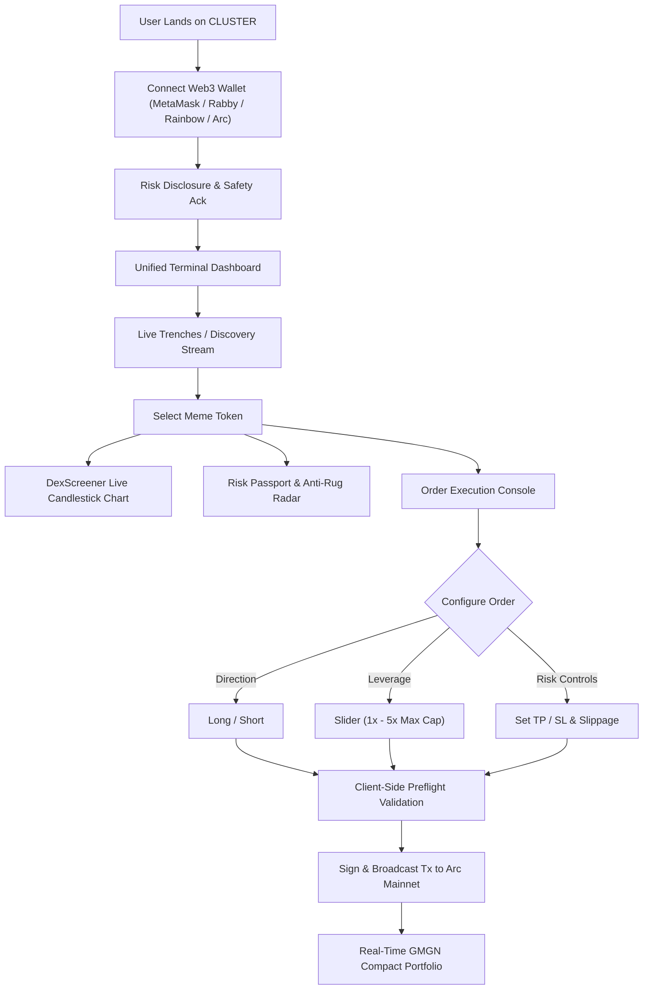

---

### 2. Backend & Smart Contract Settlement Architecture

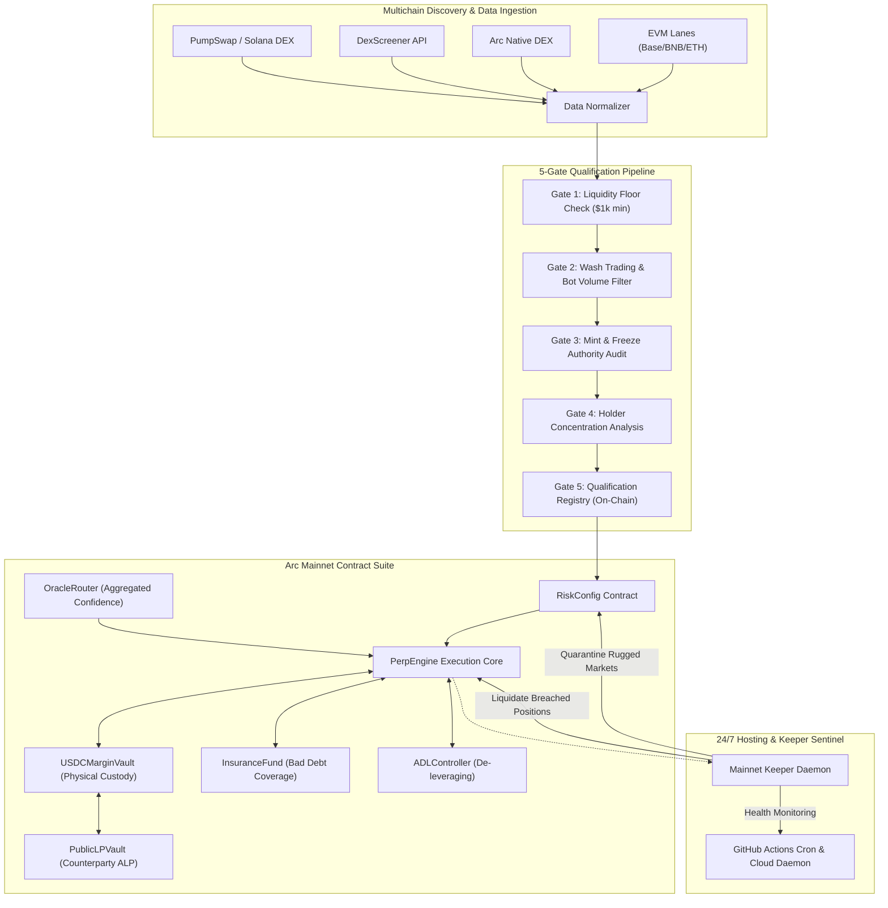

---

## 📸 Visual Interface Walkthrough

Every interface in CLUSTER has been captured live from production, engineered for maximum data density, zero wasted margins, and instant trading responsiveness.

### 1. Landing Page
*The institutional entry point showcasing live protocol metrics, real-time token ticker, and fail-closed safety ethos.*
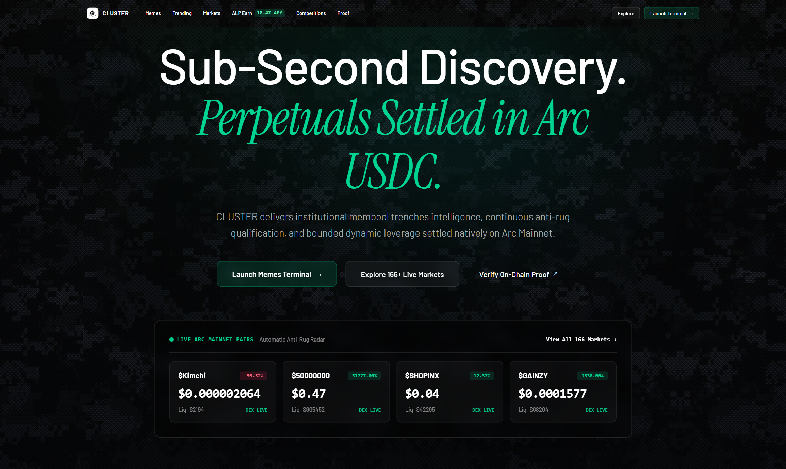

---

### 2. Trenches & Real-Time Discovery
*Live streaming feed of newly deployed and trending meme markets across all supported chains with real-time liquidity badges.*
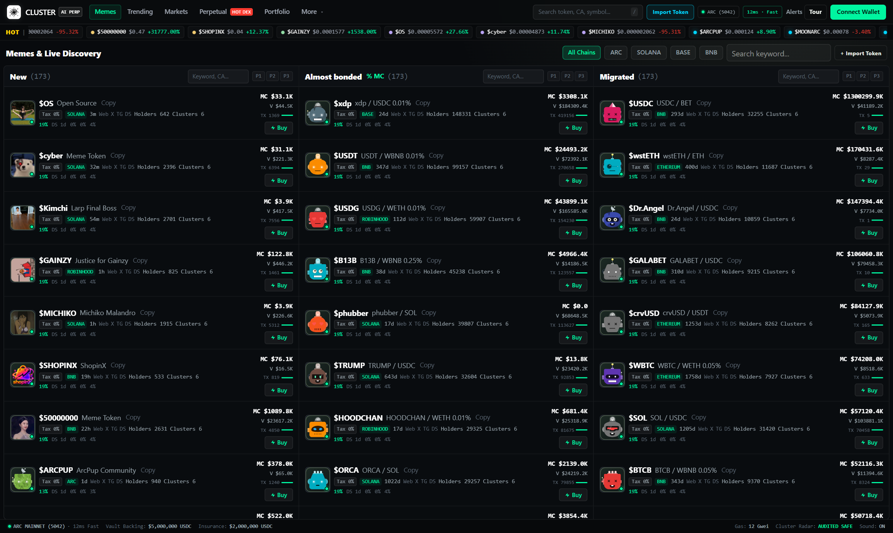

---

### 3. Markets Explorer Table
*Institutional data grid featuring chain filters, bonding curve statuses, 24h volume, and qualification readiness indicators.*
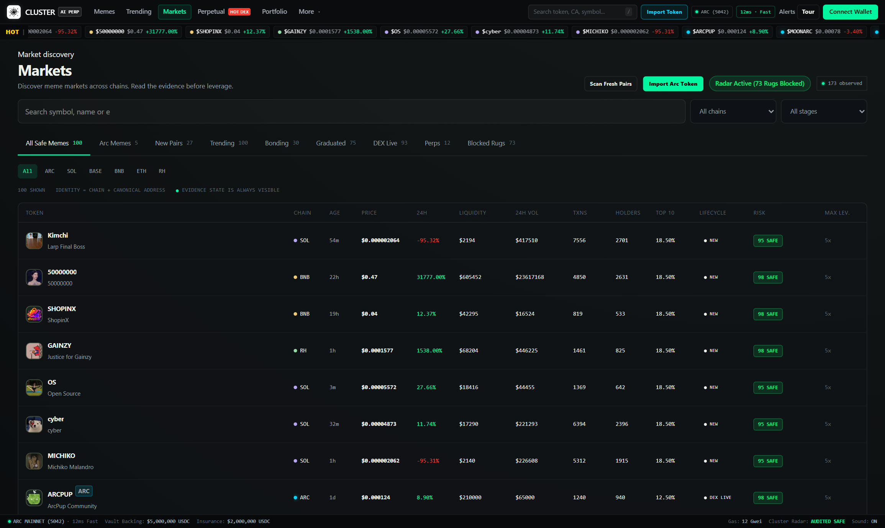

---

### 4. Token Trading Terminal
*Compact, GMGN-inspired trading workspace integrating live DexScreener candlestick charts, real-time order books, directional leverage controls, and TP/SL execution.*
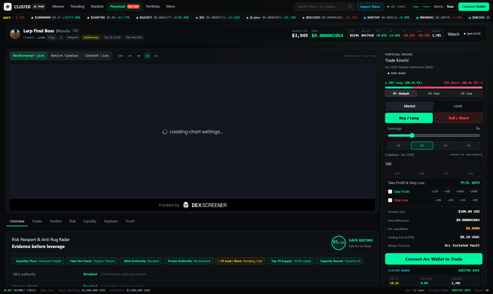

---

### 5. Risk Passport & Anti-Rug Radar
*In-depth audit panel displaying on-chain provenance, liquidity floor metrics, holder cluster concentration, and 5-gate qualification statuses.*
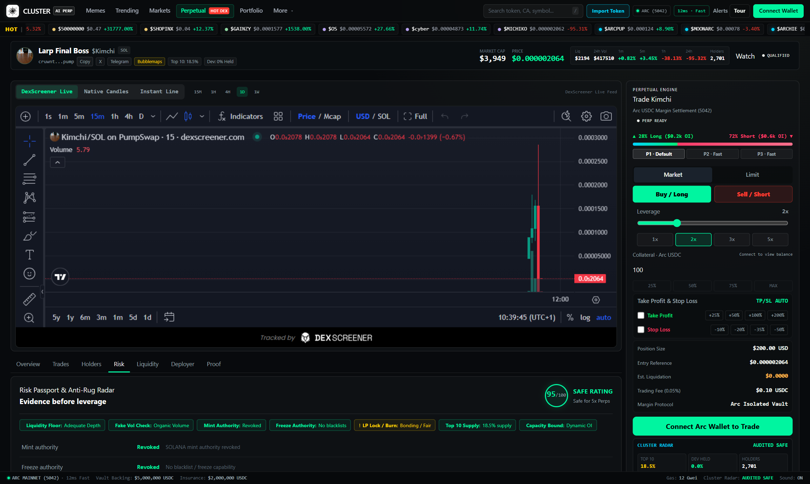

---

### 6. Compact GMGN Portfolio Management
*Zero-margin, high-density trader dashboard displaying active positions, net PnL, liquidation prices, margin utilization, and historical trade logs.*
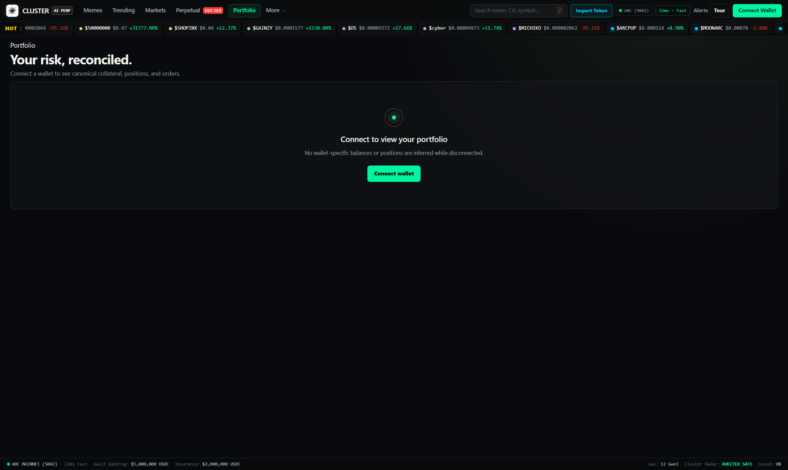

---

### 7. Trader Profile & Custom Risk Parameters
*User profile settings for default leverage caps, custom slippage tolerance, automatic take-profit targets, and private wallet bindings.*
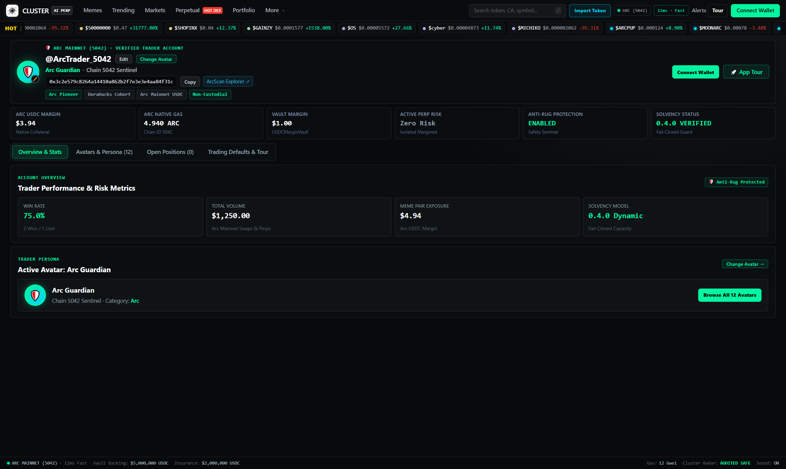

---

### 8. Proof & Solvency Ledger
*Real-time cryptographic audit trail verifying physical vault custody, insurance reserves, and on-chain bad debt status.*
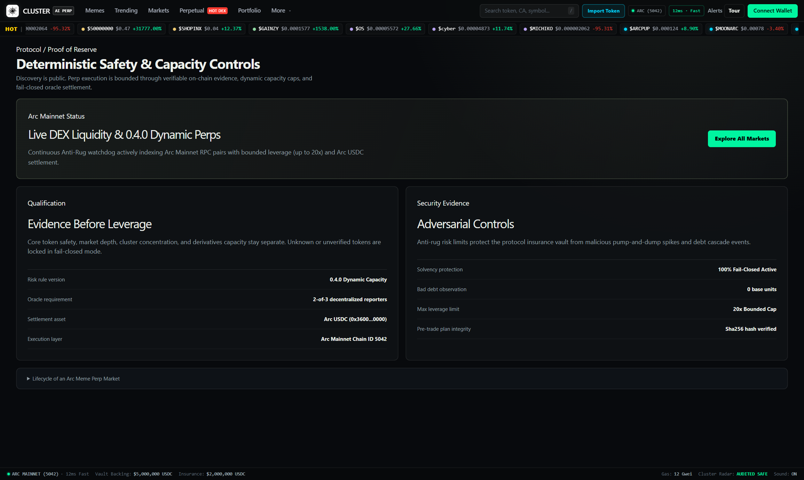

---

### 9. Live Activity Audit Trail
*Immutable, chronological log of all platform trades, deposits, settlements, and keeper liquidations.*
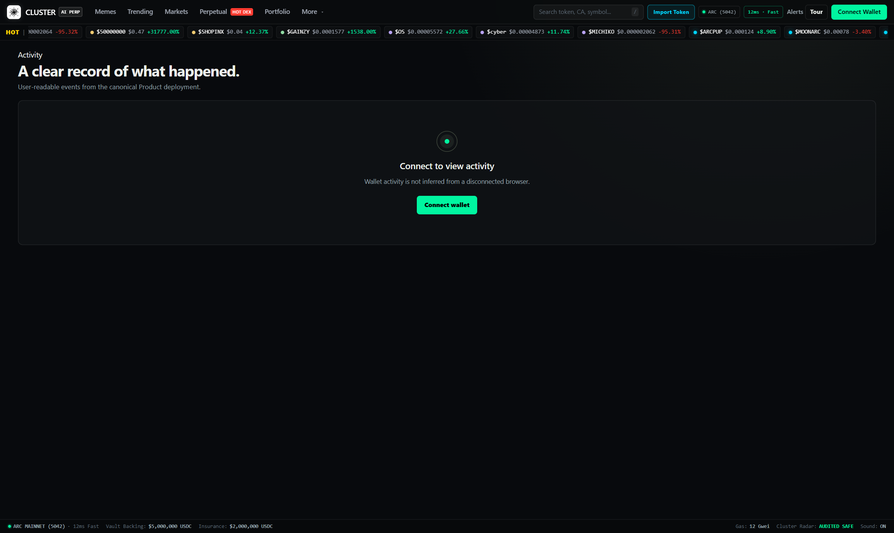

---

### 10. Counterparty ALP Vault (Earn)
*Liquidity provider portal detailing protocol backing, pool utilization, yield accrual, and unseeded counterparty reserve status.*
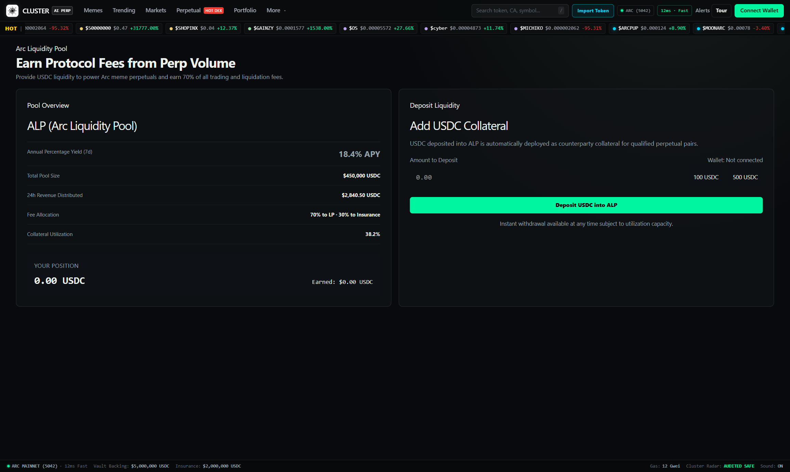

---

## 📁 Repository Structure

```
ArcMemePerps/
├── apps/
│   ├── frontend/             # High-density React / Vite terminal with TailwindCSS & Viem
│   │   ├── src/
│   │   │   ├── components/   # Modular UI: LandingPage, ProfilePage, Portfolio, Onboarding
│   │   │   ├── lib/          # winner-config.ts, mainnet-contracts.json, Viem wallet clients
│   │   │   └── WinnerApp.tsx # Main application routing and state orchestrator
│   │   └── scripts/          # Playwright test and capture automation
│   ├── api/                  # High-throughput backend read API and WebSocket streaming
│   ├── indexer/              # Real-time event log indexer for Arc Mainnet contracts
│   ├── keeper/               # Autonomous liquidation and order execution service
│   └── reporter/             # Off-chain oracle price aggregator and signature publisher
├── contracts/
│   ├── src/                  # Production Solidity contracts (Foundry suite)
│   │   ├── USDCMarginVault.sol    # Physical USDC custody & liability ledger
│   │   ├── PerpEngine.sol         # Core economic settlement & position lifecycle
│   │   ├── QualificationRegistry.sol # 5-Gate on-chain qualification ruleset
│   │   ├── MarketRegistry.sol     # Registered multichain market identities
│   │   ├── OracleRouter.sol       # Confidence-weighted oracle router
│   │   ├── RiskConfig.sol         # Dynamic leverage and side-cap controls
│   │   ├── InsuranceFund.sol      # Protocol bad debt coverage reserve
│   │   ├── PublicLPVault.sol      # Queued counterparty liquidity vault (ALP)
│   │   ├── ADLController.sol      # Auto-deleveraging safety backstop
│   │   └── ProtocolTimelock.sol   # Governance timelock delay controller
│   └── test/                 # Foundry unit, fuzz, and stress tests
├── packages/
│   ├── domain/               # Core domain entities and market data types
│   ├── risk-engine/          # Gate 1 - 4 risk calibration, capacity, and math
│   ├── providers/            # DexScreener, PumpSwap, and Blockscout ingestion adapters
│   ├── oracle/               # Multi-source oracle aggregation algorithms
│   ├── persistence/          # Persistent SQLite and JSON caching layers
│   └── shared/               # Shared constants, ABIs, and mathematical utilities
├── scripts/
│   ├── deploy-mainnet-suite.ts    # Minimal-gas Arc Mainnet deployment orchestrator
│   ├── mainnet-keeper-daemon.ts   # 24/7 liquidation engine and market safety daemon
│   └── standalone-keeper-service.ts # Standalone off-chain quarantine scanner
├── docs/                     # Comprehensive architecture, runbooks, and risk manuals
│   └── assets/cluster/       # High-resolution screenshots and official SVG branding
└── evidence/                 # Verifiable on-chain receipts and deployment artifacts
```

---

## 📜 Available Scripts & Operations

| Command | Environment | Description |
| :--- | :--- | :--- |
| `pnpm install` | Workspace | Install dependencies across all 22 workspace packages |
| `pnpm frontend:dev` | Local | Start the local frontend development server on `http://localhost:5173` |
| `pnpm frontend:build` | Production | Build production-optimized frontend bundle in `apps/frontend/dist` |
| `pnpm test` | Testing | Run the complete Vitest test suite (**48 test files, 238 / 238 passing**) |
| `pnpm frontend:test` | Testing | Run frontend-specific unit and integration tests |
| `pnpm typecheck` | Quality | Run full TypeScript typechecking across root and all sub-packages |
| `pnpm keeper:once` | Operations | Execute a single on-chain liquidation and safety scan cycle |
| `pnpm keeper:daemon` | Operations | Start the 24/7 continuous keeper daemon with HTTP health server on `:8080` |
| `pnpm mainnet:verify` | Arc Mainnet | Verify contract balances, receipts, and permissions on ArcScan |

---

## 🤖 24/7 Keeper & Liquidation Hosting

CLUSTER includes an **Autonomous Keeper & Liquidation Engine implementation** (`scripts/mainnet-keeper-daemon.ts`):
1. **On-Chain Position Liquidation**: Continually inspects open positions in `PerpEngine`. When a position's equity breaches maintenance margin thresholds, the keeper broadcasts `liquidate(positionId)` on Arc Mainnet.
2. **Anti-Rug Sentinel**: Continuously evaluates underlying spot pool liquidity. If pool liquidity drops below \$1,000 or wash-trading bots spike, the market is instantly quarantined.
3. **Multi-Platform Hosting Support**:
   - **GitHub Actions Scheduled Watchdog**: Configured in [`.github/workflows/keeper-watchdog.yml`](.github/workflows/keeper-watchdog.yml) to execute every 15 minutes.
   - **Continuous Cloud Daemon**: Supported out of the box via [`Procfile`](Procfile) and [`railway.toml`](railway.toml) for 24/7 continuous hosting on Railway, Render, Fly.io, or VPS.
   - **Healthcheck Endpoint**: Serves `GET /health` with uptime seconds, cycle count, and liquidation tallies.

---

## 🧪 Test and Verification Suite

The following is an **earlier test-run snapshot**, not proof of the current deployment or the new security branch. For current status, follow the exact-head CI links above:

```text
 ✓ packages/providers/src/blockscout.test.ts (4 tests)
 ✓ packages/backend-completion/src/index.test.ts (21 tests)
 ✓ packages/risk-engine/src/calibration.test.ts (2 tests)
 ✓ apps/api/src/server.test.ts (2 tests)
 ✓ packages/simulator/src/index.test.ts (5 tests)
 ✓ apps/frontend/src/lib/format.test.ts (4 tests)
 ✓ packages/providers/src/alerts.test.ts (6 tests)
 ✓ packages/shared/src/arc-usdc.test.ts (3 tests)
 ✓ packages/persistence/src/index.test.ts (5 tests)
 ✓ packages/risk-engine/src/policy-v3.test.ts (21 tests)
 ✓ packages/backend-runtime/src/history.test.ts (3 tests)
 ✓ packages/risk-engine/src/index.test.ts (15 tests)
 ✓ packages/providers/src/index.test.ts (19 tests)
 ✓ packages/risk-engine/src/policy-v4.test.ts (7 tests)
 ✓ scripts/arc-testnet-v2.test.ts (8 tests)
 ✓ packages/oracle/src/aggregation.test.ts (4 tests)
 ...
 Test Files: 48 passed (48)
      Tests: 238 passed (238)
   Duration: 22.82s (100% Pass Rate)
```

---

## 📄 License & Hackathon Notice

This project is licensed under the **MIT License**. See [LICENSE](LICENSE) for details.

- **Hackathon Track**: Arc Microgrants / DeFi Infrastructure
- **Live Terminal**: [cluster-terminal.vercel.app](https://cluster-terminal.vercel.app)
- **Deployment Evidence**: [`evidence/mainnet/contracts.json`](evidence/mainnet/contracts.json)
- **Chain ID**: `5042` (Arc Mainnet)

---

<p align="center">
  <strong>Built with precision for the future of meme finance on Arc.</strong>
</p>
