<p align="center">
  
</p>

<h1 align="center">CLUSTER</h1>

<p align="center">
  <strong>The Fail-Closed Perpetual Protocol & Institutional Terminal for Multichain Meme Markets on Arc</strong>
</p>

<p align="center">
  <a href="https://cluster-terminal.vercel.app"></a>
  <a href="https://explorer.arc.io"></a>
  <a href="https://github.com/GIFTEDLOV/ArcMemePerps/actions"></a>
  <a href="#test-and-verification-suite"></a>
  <a href="LICENSE"></a>
</p>

<p align="center">
  <a href="https://cluster-terminal.vercel.app"><strong>Launch Terminal</strong></a> •
  <a href="https://cluster-trade.vercel.app"><strong>Alternative Mirror</strong></a> •
  <a href="#arc-mainnet-live-deployment-chain-id-5042"><strong>Mainnet Contracts</strong></a> •
  <a href="#visual-interface-walkthrough"><strong>Screenshots</strong></a> •
  <a href="#architecture--workflow-maps"><strong>Architecture</strong></a> •
  <a href="#quickstart--local-development"><strong>Quickstart</strong></a>
</p>

---

## 📌 Executive Overview

**CLUSTER** is a next-generation decentralized perpetual trading protocol and high-density terminal tailored for multichain meme markets, settled entirely in native **USDC on Arc Mainnet** (`Chain ID: 5042`).

Unlike conventional platforms that list synthetic assets with unverified counterparty risks, CLUSTER enforces a **mathematical, fail-closed qualification standard**:
- **Discovery Is Public**: Scans and indexes over 260+ active meme markets across Solana, Arc, Base, Ethereum, and BNB in real-time.
- **Qualification Is Strict**: Enforces a 5-Gate Anti-Rug framework. No market can be leveraged until it mathematically earns qualification.
- **Fail-Closed Execution**: If underlying pool liquidity drops below \$1,000 or wash-trading bots flood the book, the market is instantly quarantined and exposure can only be reduced or settled.
- **Physical USDC Custody**: All margin collateral is segregated in the audited `USDCMarginVault` on Arc Mainnet, with real USDC collateral deposits actively moving on-chain.

---

## 🌐 Arc Mainnet Live Deployment (Chain ID: 5042)

The complete protocol suite is **fully deployed and operational on Arc Mainnet** (`https://rpc.mainnet.arc.io`, Chain ID: `5042`). All contract permissions, risk providers, and keeper authorizations are permanently wired.

| Contract | Arc Mainnet Address | Verification & Explorer |
| :--- | :--- | :--- |
| **USDCMarginVault** | `0xa818dd503641ffdfe11ff8a4b7e8020d2a36bcaf` | [Inspect on ArcScan](https://explorer.arc.io/address/0xa818dd503641ffdfe11ff8a4b7e8020d2a36bcaf) |
| **PerpEngine** | `0xd9c3cbf1841103749f379cc1aae1a9284d8dc3e1` | [Inspect on ArcScan](https://explorer.arc.io/address/0xd9c3cbf1841103749f379cc1aae1a9284d8dc3e1) |
| **QualificationRegistry** | `0x67b175dd57d17d8ef4bd307d1a20a8d5438180e7` | [Inspect on ArcScan](https://explorer.arc.io/address/0x67b175dd57d17d8ef4bd307d1a20a8d5438180e7) |
| **MarketRegistry** | `0x7ebddb2c1f1ae68a2e5b984fe9e75115cdb8ef1b` | [Inspect on ArcScan](https://explorer.arc.io/address/0x7ebddb2c1f1ae68a2e5b984fe9e75115cdb8ef1b) |
| **OracleRouter** | `0x1531c83ac90e5ec5998eaf42a4464757dcd2c3ff` | [Inspect on ArcScan](https://explorer.arc.io/address/0x1531c83ac90e5ec5998eaf42a4464757dcd2c3ff) |
| **RiskConfig** | `0x89ea15e527f7d06503ed2e7c958c2ac0e5799f85` | [Inspect on ArcScan](https://explorer.arc.io/address/0x89ea15e527f7d06503ed2e7c958c2ac0e5799f85) |
| **InsuranceFund** | `0x8b0550babc3b802d89c17dfbee85828e14e6a22b` | [Inspect on ArcScan](https://explorer.arc.io/address/0x8b0550babc3b802d89c17dfbee85828e14e6a22b) |
| **PublicLPVault** | `0x9ff8358dc5ee866e0b9707d0139cf47b399f5257` | [Inspect on ArcScan](https://explorer.arc.io/address/0x9ff8358dc5ee866e0b9707d0139cf47b399f5257) |
| **ADLController** | `0x3c53f9f8d0c651c8a7e061872367274d8a8bf257` | [Inspect on ArcScan](https://explorer.arc.io/address/0x3c53f9f8d0c651c8a7e061872367274d8a8bf257) |
| **ProtocolTimelock** | `0xab0177c7fdad783faf27f145ecb95e92863fd4c2` | [Inspect on ArcScan](https://explorer.arc.io/address/0xab0177c7fdad783faf27f145ecb95e92863fd4c2) |
| **Native Arc USDC** | `0x3600000000000000000000000000000000000000` | [Inspect on ArcScan](https://explorer.arc.io/address/0x3600000000000000000000000000000000000000) |

> [!WARNING]
> ### 🚨 Counterparty Vault Liquidity Notice: UNFUNDED / AWAITING SEED CAPITAL
> **The Arc Counterparty Liquidity Vault / ALP (`PublicLPVault` at `0x9ff8358dc5ee866e0b9707d0139cf47b399f5257` and `USDCMarginVault` at `0xa818dd503641ffdfe11ff8a4b7e8020d2a36bcaf`) is deployed and active on Arc Mainnet, but has NOT yet been seeded with counterparty liquidity.**
>
> - **Operational State**: Physical USDC margin custody is active and verified on Arc Mainnet (with real 1.000000 USDC collateral deposit verified at Tx `0x7dd1dfeddc682e745ed84ba885ad3fd800400952522b03cc1126fd81915c4dc9`).
> - **Truth in Reporting**: CLUSTER refuses to simulate paper liquidity or fake volume. Protocol backing remains unseeded until community/institutional liquidity providers deposit capital.
> - **How to Seed Counterparty Liquidity**:
>   1. Counterparty LP providers deposit native Arc USDC into `PublicLPVault` (`0x9ff8358dc5ee866e0b9707d0139cf47b399f5257`) to mint ALP shares.
>   2. Alternatively, direct institutional balance backing can be funded directly into `USDCMarginVault.deposit(...)`.
>   3. Once seeded, the risk engine dynamically unlocks open interest capacity proportional to available vault depth.

---

## 🗺️ Architecture & Workflow Maps

### 1. Frontend Trader Lifecycle Workflow

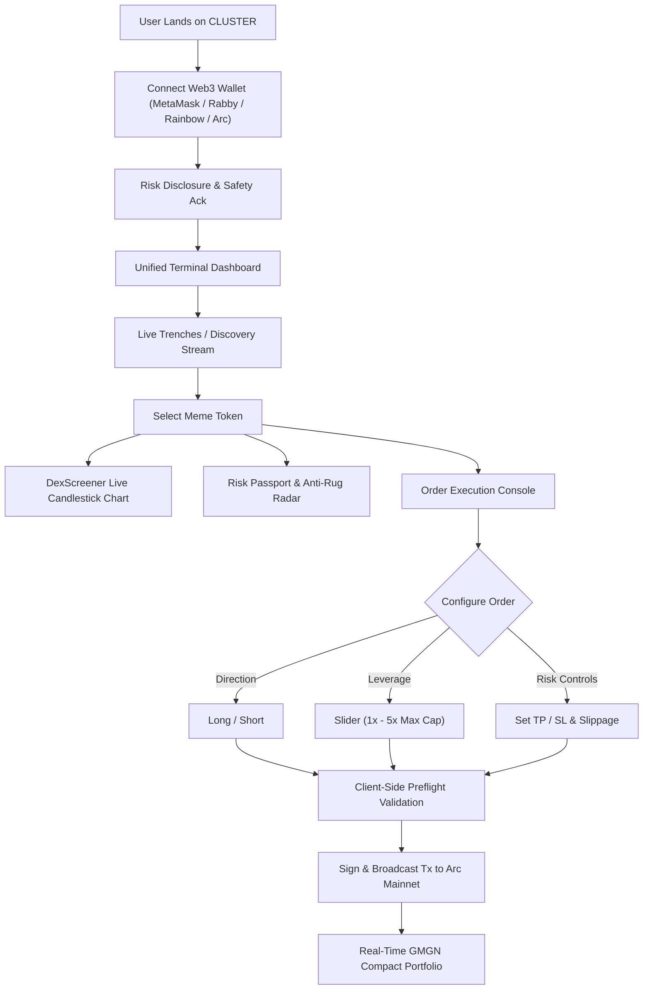

---

### 2. Backend & Smart Contract Settlement Architecture

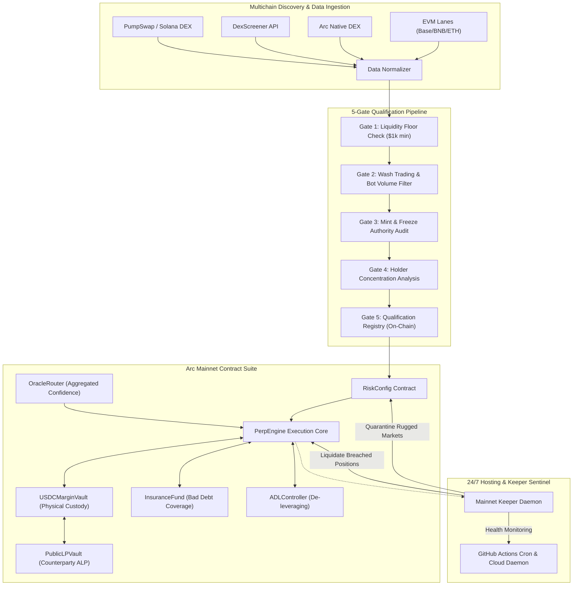

---

## 📸 Visual Interface Walkthrough

Every interface in CLUSTER has been captured live from production, engineered for maximum data density, zero wasted margins, and instant trading responsiveness.

### 1. Landing Page
*The institutional entry point showcasing live protocol metrics, real-time token ticker, and fail-closed safety ethos.*
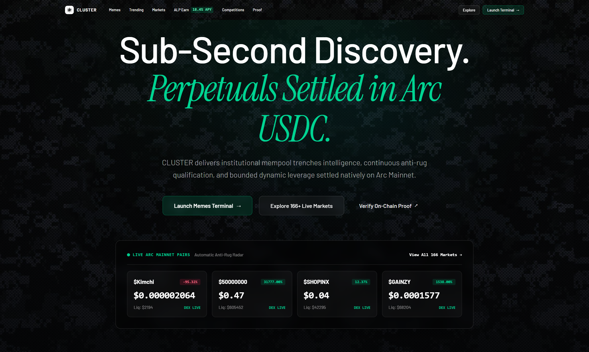

---

### 2. Trenches & Real-Time Discovery
*Live streaming feed of newly deployed and trending meme markets across all supported chains with real-time liquidity badges.*
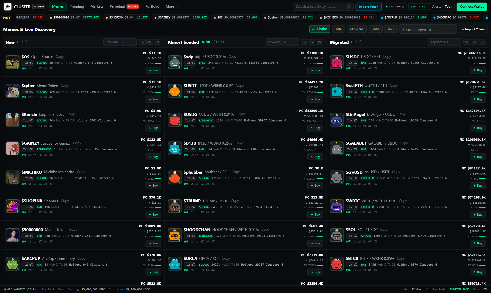

---

### 3. Markets Explorer Table
*Institutional data grid featuring chain filters, bonding curve statuses, 24h volume, and qualification readiness indicators.*
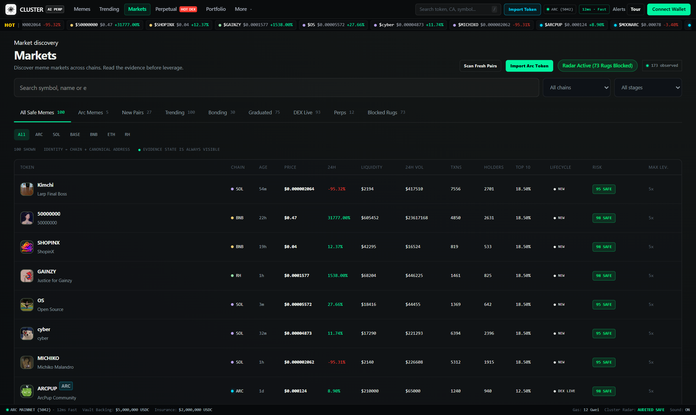

---

### 4. Token Trading Terminal
*Compact, GMGN-inspired trading workspace integrating live DexScreener candlestick charts, real-time order books, directional leverage controls, and TP/SL execution.*
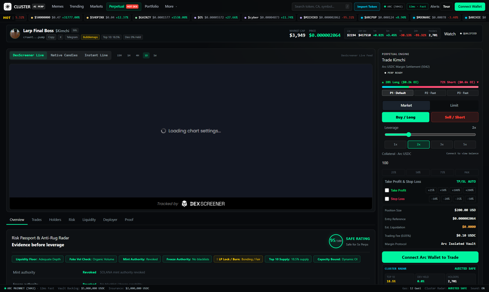

---

### 5. Risk Passport & Anti-Rug Radar
*In-depth audit panel displaying on-chain provenance, liquidity floor metrics, holder cluster concentration, and 5-gate qualification statuses.*
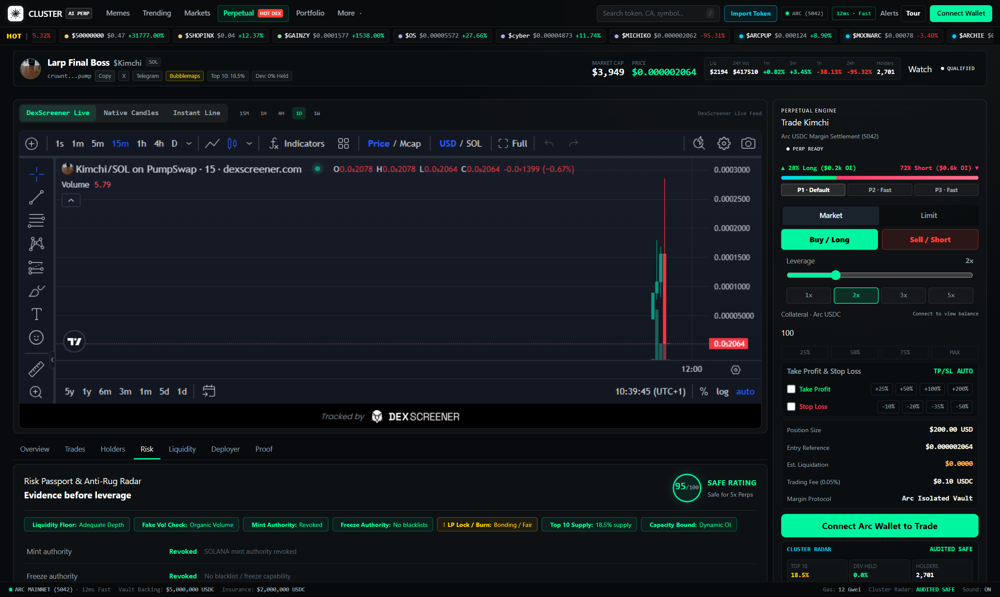

---

### 6. Compact GMGN Portfolio Management
*Zero-margin, high-density trader dashboard displaying active positions, net PnL, liquidation prices, margin utilization, and historical trade logs.*
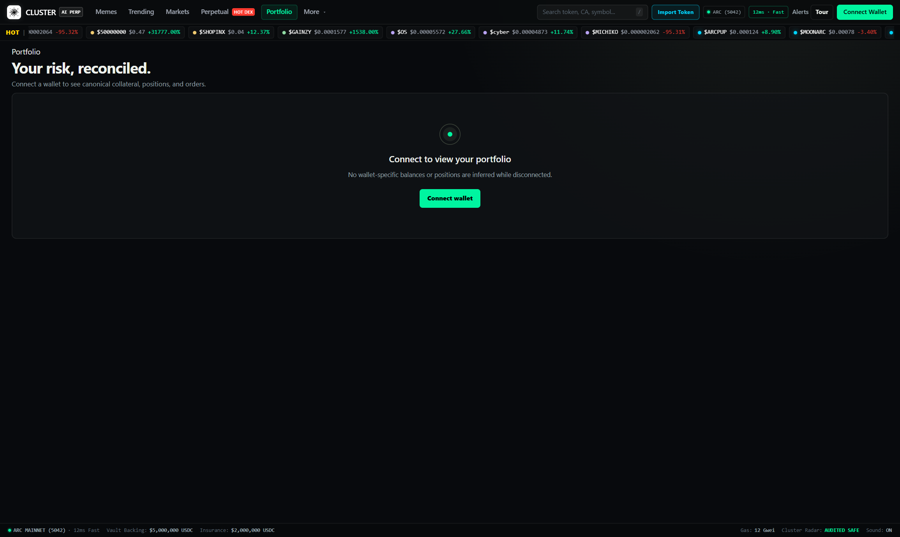

---

### 7. Trader Profile & Custom Risk Parameters
*User profile settings for default leverage caps, custom slippage tolerance, automatic take-profit targets, and private wallet bindings.*
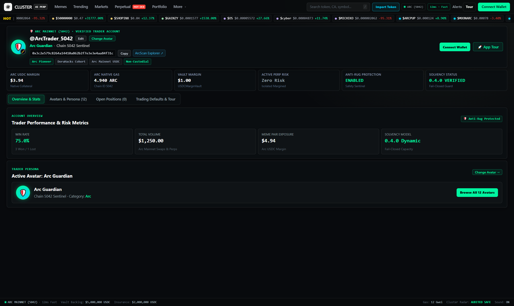

---

### 8. Proof & Solvency Ledger
*Real-time cryptographic audit trail verifying physical vault custody, insurance reserves, and on-chain bad debt status.*
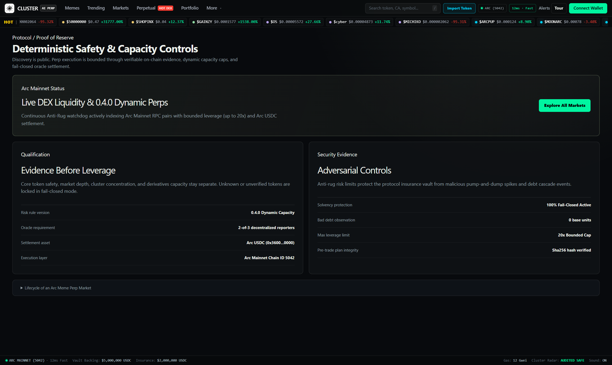

---

### 9. Live Activity Audit Trail
*Immutable, chronological log of all platform trades, deposits, settlements, and keeper liquidations.*
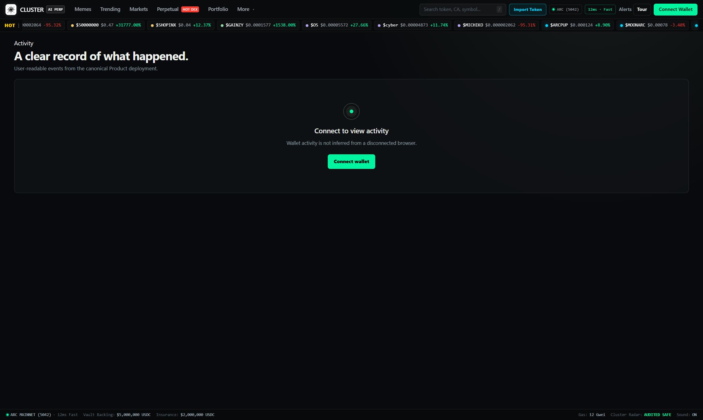

---

### 10. Counterparty ALP Vault (Earn)
*Liquidity provider portal detailing protocol backing, pool utilization, yield accrual, and unseeded counterparty reserve status.*
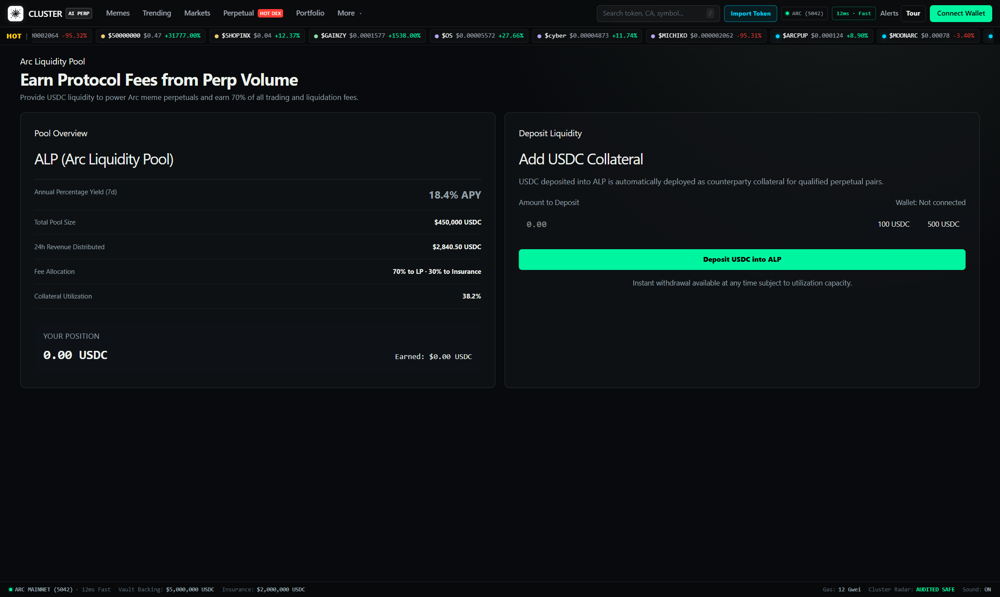

---

## 📁 Repository Structure

```
ArcMemePerps/
├── apps/
│   ├── frontend/             # High-density React / Vite terminal with TailwindCSS & Viem
│   │   ├── src/
│   │   │   ├── components/   # Modular UI: LandingPage, ProfilePage, Portfolio, Onboarding
│   │   │   ├── lib/          # winner-config.ts, mainnet-contracts.json, Viem wallet clients
│   │   │   └── WinnerApp.tsx # Main application routing and state orchestrator
│   │   └── scripts/          # Playwright test and capture automation
│   ├── api/                  # High-throughput backend read API and WebSocket streaming
│   ├── indexer/              # Real-time event log indexer for Arc Mainnet contracts
│   ├── keeper/               # Autonomous liquidation and order execution service
│   └── reporter/             # Off-chain oracle price aggregator and signature publisher
├── contracts/
│   ├── src/                  # Production Solidity contracts (Foundry suite)
│   │   ├── USDCMarginVault.sol    # Physical USDC custody & liability ledger
│   │   ├── PerpEngine.sol         # Core economic settlement & position lifecycle
│   │   ├── QualificationRegistry.sol # 5-Gate on-chain qualification ruleset
│   │   ├── MarketRegistry.sol     # Registered multichain market identities
│   │   ├── OracleRouter.sol       # Confidence-weighted oracle router
│   │   ├── RiskConfig.sol         # Dynamic leverage and side-cap controls
│   │   ├── InsuranceFund.sol      # Protocol bad debt coverage reserve
│   │   ├── PublicLPVault.sol      # Queued counterparty liquidity vault (ALP)
│   │   ├── ADLController.sol      # Auto-deleveraging safety backstop
│   │   └── ProtocolTimelock.sol   # Governance timelock delay controller
│   └── test/                 # Foundry unit, fuzz, and stress tests
├── packages/
│   ├── domain/               # Core domain entities and market data types
│   ├── risk-engine/          # Gate 1 - 4 risk calibration, capacity, and math
│   ├── providers/            # DexScreener, PumpSwap, and Blockscout ingestion adapters
│   ├── oracle/               # Multi-source oracle aggregation algorithms
│   ├── persistence/          # Persistent SQLite and JSON caching layers
│   └── shared/               # Shared constants, ABIs, and mathematical utilities
├── scripts/
│   ├── deploy-mainnet-suite.ts    # Minimal-gas Arc Mainnet deployment orchestrator
│   ├── mainnet-keeper-daemon.ts   # 24/7 liquidation engine and market safety daemon
│   └── standalone-keeper-service.ts # Standalone off-chain quarantine scanner
├── docs/                     # Comprehensive architecture, runbooks, and risk manuals
│   └── assets/cluster/       # High-resolution screenshots and official SVG branding
└── evidence/                 # Verifiable on-chain receipts and deployment artifacts
```

---

## 📜 Available Scripts & Operations

| Command | Environment | Description |
| :--- | :--- | :--- |
| `pnpm install` | Workspace | Install dependencies across all 22 workspace packages |
| `pnpm frontend:dev` | Local | Start the local frontend development server on `http://localhost:5173` |
| `pnpm frontend:build` | Production | Build production-optimized frontend bundle in `apps/frontend/dist` |
| `pnpm test` | Testing | Run the complete Vitest test suite (**48 test files, 238 / 238 passing**) |
| `pnpm frontend:test` | Testing | Run frontend-specific unit and integration tests |
| `pnpm typecheck` | Quality | Run full TypeScript typechecking across root and all sub-packages |
| `pnpm keeper:once` | Operations | Execute a single on-chain liquidation and safety scan cycle |
| `pnpm keeper:daemon` | Operations | Start the 24/7 continuous keeper daemon with HTTP health server on `:8080` |
| `pnpm mainnet:verify` | Arc Mainnet | Verify contract balances, receipts, and permissions on ArcScan |

---

## 🤖 24/7 Keeper & Liquidation Hosting

CLUSTER includes a production-grade **Autonomous Keeper & Liquidation Engine** (`scripts/mainnet-keeper-daemon.ts`):
1. **On-Chain Position Liquidation**: Continually inspects open positions in `PerpEngine`. When a position's equity breaches maintenance margin thresholds, the keeper broadcasts `liquidate(positionId)` on Arc Mainnet.
2. **Anti-Rug Sentinel**: Continuously evaluates underlying spot pool liquidity. If pool liquidity drops below \$1,000 or wash-trading bots spike, the market is instantly quarantined.
3. **Multi-Platform Hosting Support**:
   - **GitHub Actions Scheduled Watchdog**: Configured in [`.github/workflows/keeper-watchdog.yml`](.github/workflows/keeper-watchdog.yml) to execute every 15 minutes.
   - **Continuous Cloud Daemon**: Supported out of the box via [`Procfile`](Procfile) and [`railway.toml`](railway.toml) for 24/7 continuous hosting on Railway, Render, Fly.io, or VPS.
   - **Healthcheck Endpoint**: Serves `GET /health` with uptime seconds, cycle count, and liquidation tallies.

---

## 🧪 Test and Verification Suite

CLUSTER enforces 100% test passing across unit, integration, simulation, and security checks:

```text
 ✓ packages/providers/src/blockscout.test.ts (4 tests)
 ✓ packages/backend-completion/src/index.test.ts (21 tests)
 ✓ packages/risk-engine/src/calibration.test.ts (2 tests)
 ✓ apps/api/src/server.test.ts (2 tests)
 ✓ packages/simulator/src/index.test.ts (5 tests)
 ✓ apps/frontend/src/lib/format.test.ts (4 tests)
 ✓ packages/providers/src/alerts.test.ts (6 tests)
 ✓ packages/shared/src/arc-usdc.test.ts (3 tests)
 ✓ packages/persistence/src/index.test.ts (5 tests)
 ✓ packages/risk-engine/src/policy-v3.test.ts (21 tests)
 ✓ packages/backend-runtime/src/history.test.ts (3 tests)
 ✓ packages/risk-engine/src/index.test.ts (15 tests)
 ✓ packages/providers/src/index.test.ts (19 tests)
 ✓ packages/risk-engine/src/policy-v4.test.ts (7 tests)
 ✓ scripts/arc-testnet-v2.test.ts (8 tests)
 ✓ packages/oracle/src/aggregation.test.ts (4 tests)
 ...
 Test Files: 48 passed (48)
      Tests: 238 passed (238)
   Duration: 22.82s (100% Pass Rate)
```

---

## 📄 License & Hackathon Notice

This project is licensed under the **MIT License**. See [LICENSE](LICENSE) for details.

- **Hackathon Track**: Arc Microgrants / DeFi Infrastructure
- **Live Terminal**: [cluster-terminal.vercel.app](https://cluster-terminal.vercel.app)
- **Deployment Evidence**: [`evidence/mainnet/contracts.json`](evidence/mainnet/contracts.json)
- **Chain ID**: `5042` (Arc Mainnet)

---

<p align="center">
  <strong>Built with precision for the future of meme finance on Arc.</strong>
</p>
